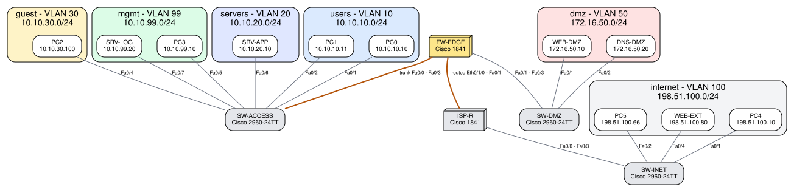
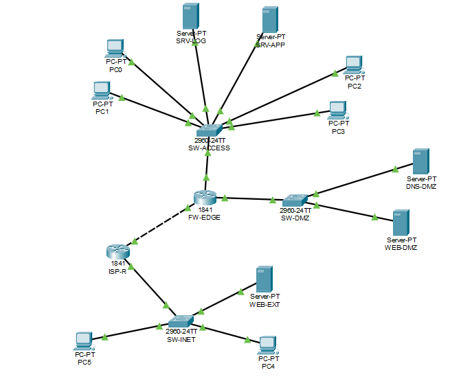
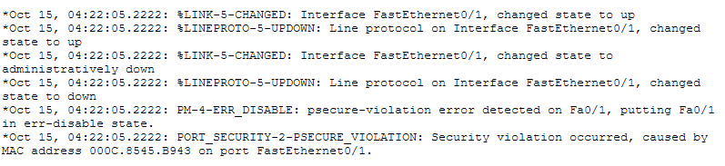
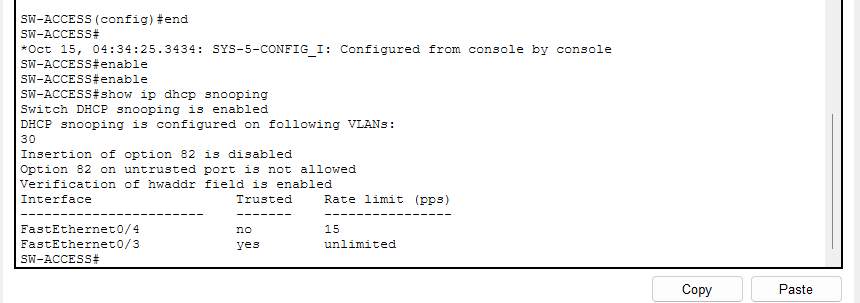
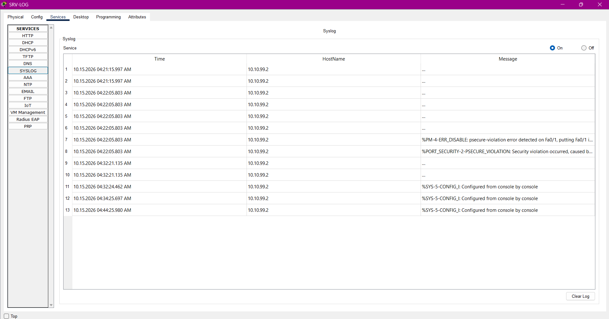

# Defensive Network Security Lab

A segmented enterprise network (firewall router, DMZ, guest, management and server zones) built and validated in Cisco Packet Tracer, together with **`ciscoaudit`**, a Python tool that audits Cisco IOS configurations for insecure settings and **checks that the network's access lists implement a written security policy**.

It started as a flat university lab (four routers, three switches, no passwords, no VLANs, no ACLs) and was redesigned, hardened, audited, simulated and then tested by hand in Packet Tracer. Every result below can be reproduced with one command or is recorded in [`evidence/`](evidence/README.md).



## Three layers of validation

| Layer | What it does | Result |
|---|---|---|
| **1. Automated configuration auditing** (`ciscoaudit audit`, 52 rules) | Finds insecure settings in the device configurations and reports risk, evidence and fix | Original lab 150 open findings → redesigned baseline 65 → **hardened 0 open** (5 documented, expiring accepted risks) |
| **2. Policy simulation** (`ciscoaudit validate`, `matrix`) | Evaluates the configuration text against a written policy: 124 named scenarios and a 3 146-probe reachability matrix | **115 of 115** asserted scenarios pass; **0 of 3 146** probes disagree with the policy |
| **3. Manual Packet Tracer validation** (checks X-01 to X-09) | Runs the hardened configurations on simulated devices (Packet Tracer 9.0.1) and observes the defensive behaviour | **9 of 9 checks passed** ([details](docs/packet-tracer-validation.md)) |

The three layers are independent: layers 1 and 2 are computed from the configuration files; layer 3 was performed by hand in Cisco Packet Tracer.

## Defensive behaviour observed in Packet Tracer

Run on 2026-10-15; results in [`evidence/packet-tracer/results.csv`](evidence/packet-tracer/results.csv), running configurations in [`evidence/packet-tracer/exported/`](evidence/packet-tracer/exported) (password hashes replaced by `XXXX`).

| Check | Control | Observed |
|---|---|---|
| X-01 | DHCP for the guest VLAN | Guest PC received 10.10.30.100/24, gateway 10.10.30.1, DNS 172.16.50.20 |
| X-02 | SSH-only management | SSH v2 login from the admin workstation to FW-EDGE worked; Telnet was refused |
| X-03 | Port security | A second MAC address on SW-ACCESS Fa0/1 raised `PORT_SECURITY-2-PSECURE_VIOLATION` and put the port in err-disabled |
| X-04 | NAT / PAT | Internal clients reached the external web server; the Internet reached the DMZ web server through static NAT; `show ip nat translations` listed the static and dynamic entries |
| X-05 | Default-deny outside ACL | Eight unauthorised attempts from the Internet attacker (Telnet, HTTP, SSH, RDP, SNMP and ICMP to the firewall, the published servers and an internal host) were all blocked |
| X-06 | Syslog and NTP | SRV-LOG received a syslog event from SW-ACCESS; FW-EDGE and SW-ACCESS synchronised to 10.10.99.20 (stratum 2) |
| X-07 | Running configuration | `show running-config` verified on FW-EDGE, SW-ACCESS and SW-DMZ; re-audited with `ciscoaudit` (0 critical, 0 high findings) |
| X-08 | DHCP snooping | A rogue DHCP server on VLAN 30 (Fa0/10, untrusted) did not change PC2's lease; trust and rate-limit settings confirmed |
| X-09 | Dynamic ARP Inspection | `show ip arp inspection` showed DAI enabled and active on VLAN 30 |

Packet Tracer note: its running configuration does not contain the ACL entries that use the `log` keyword (the anti-spoofing denies and the explicit final denies), so default-deny was enforced by each ACL's implicit deny, which has no hit counter; the anti-spoofing entries are demonstrated by the policy simulator. The comparison of intended and running configurations is in [`export-comparison.md`](evidence/packet-tracer/export-comparison.md).

## What is in the network

| Zone | VLAN / subnet | May do |
|---|---|---|
| Users | 10 · 10.10.10.0/24 | Use the internal app and the public web server, resolve names, browse the Internet (PAT) |
| Servers | 20 · 10.10.20.0/24 | Answer employees; resolve names |
| Guest | 30 · 10.10.30.0/24 (DHCP) | Internet and DNS only |
| Management | 99 · 10.10.99.0/24 | The administrator workstation is the only host allowed to manage devices (SSH) |
| DMZ | 50 · 172.16.50.0/24 | Public web (80/443) and DNS (53) via static NAT; one controlled flow to the app server |
| Internet (simulated) | 198.51.100.0/24 | A legitimate client and an attacker (`PC5`) |

Controls: one enforcement point (FW-EDGE) with default-deny inbound ACLs and logged denies; anti-spoofing; static NAT + PAT; SSH-only management restricted by an access class; a local administrator account and hashed secrets; DTP off, native VLAN 999, port security, BPDU Guard, parked unused ports, DHCP snooping and ARP inspection on the guest VLAN; syslog and NTP. Details: [docs/architecture.md](docs/architecture.md). Threats and how each is tested: [docs/threat-model.md](docs/threat-model.md).

## Audit results (computed, reproducible)

| Audit of | Open findings | Critical | High | Medium | Low | Accepted risk |
|---|---:|---:|---:|---:|---:|---:|
| Original university lab (7 devices) ¹ | 150 | 0 | 18 | 65 | 67 | 0 |
| Redesigned network, **baseline** configuration | 65 | 3 | 7 | 33 | 22 | 0 |
| Redesigned network, **hardened** configuration | **0** | 0 | 0 | 0 | 0 | 5 (documented, expiring) |

¹ Of the 150 original findings, 85 belong to devices that the new design no longer has (Router2, Router3, Router4, Switch2); `compare` reports them as *left scope*, not as fixed. See [`evidence/audit/compare-original-to-hardened.md`](evidence/audit/compare-original-to-hardened.md).

The reachability matrix shows the effect of segmentation: the baseline lets 1 447 probes cross zones; the hardened network 87, every one of them listed in the written policy.

## Quick start

Requires Python 3.11+ and PyYAML (`pip install pyyaml`). No network access is needed.

```bash
export PYTHONPATH=src                                   # or: pip install -e .

python -m ciscoaudit audit configs/baseline -v          # find the insecure settings
python -m ciscoaudit audit configs/hardened --waivers waivers/hardened.yaml
python -m ciscoaudit validate --state hardened          # 124 scenarios
python -m ciscoaudit trace "PC5 -> 203.0.113.9 tcp/22"  # explain one flow hop by hop
python -m ciscoaudit matrix                             # every sender x destination x service vs. the written policy
python -m ciscoaudit rules                              # what is checked

make all                                                # everything above plus the unit tests and the consistency checks
```

### Example: auditing the baseline firewall (excerpt of the real output)

```text
$ python -m ciscoaudit audit configs/baseline/FW-EDGE.cfg -v
CRITICAL CRED-004  FW-EDGE: A well-known or default password is in use
          Matches the built-in list of well-known passwords (the value is deliberately not shown): enable password, line con 0, line vty 0 4.
           L18 enable password <redacted>
           fix: Replace the credential with a unique passphrase (14+ characters) and rotate anything derived from it.
HIGH     MGMT-001  FW-EDGE: Telnet is accepted for remote management
          Telnet is permitted on: line vty 0 4 (no 'transport input': IOS default accepts Telnet).
           fix: Allow only SSH on the VTY lines: 'line vty 0 15' / 'transport input ssh'.
HIGH     MGMT-005  FW-EDGE: HTTP management server is enabled
MEDIUM   ACL-001   FW-EDGE: ACL contains a 'permit any any' entry
          'access-list 101 permit ip any any' permits all traffic after some deny entries (blocklist style).
```

### Example: why an attack fails (excerpt of the real output)

```text
$ python -m ciscoaudit trace "PC5 -> 203.0.113.9 tcp/22" --state hardened
[hardened] PC5 -> 203.0.113.9 tcp/22
  request denied at FW-EDGE: Ethernet0/1/0 in ACL IN-OUTSIDE: 'deny ip any any log' (line 204)
     1. PC5: sends to its gateway ISP-R FastEthernet0/0 (198.51.100.1)
     2. ISP-R: FastEthernet0/0 in: no ACL, everything is permitted
     3. ISP-R: 203.0.113.9 via static route 203.0.113.8/29 -> FastEthernet0/1, next hop 203.0.113.2
     4. ISP-R: forwards to FW-EDGE Ethernet0/1/0 (203.0.113.2)
     5. FW-EDGE: Ethernet0/1/0 in: ACL IN-OUTSIDE denies - 'deny ip any any log' (line 204)
```

## The auditor

* 52 rules in nine categories (access control, credentials, management plane, access lists, Layer 2, services, routing, logging, interfaces), each with a risk statement, remediation and references ([catalogue](docs/generated/rules.md), [sources](docs/references.md)).
* Structured output: text, JSON, Markdown, CSV; known credential forms (see `tests/test_redact.py`) are redacted before they enter any finding.
* Accepted risks are **waivers** that keep the finding visible, require a reason and expire.
* `compare` shows what a remediation changed and refuses to count a decommissioned device as a fix.
* Standard library + PyYAML. Design and testing: [docs/auditor.md](docs/auditor.md).

## Validation approach

1. `design-check`: the configurations implement `topology/topology.yaml`.
2. `audit`: no open findings on the hardened configurations.
3. `validate`: each named business flow works and each named attack fails *for the stated reason* (which ACL, on which device).
4. `matrix`: nothing else gets through among the 11 probed services and 27 probed addresses.
5. Packet Tracer: nine hands-on checks of DHCP, SSH, port security, NAT, ACL enforcement, syslog/NTP, running configuration, DHCP snooping and ARP inspection ([results](docs/packet-tracer-validation.md)).

More: [docs/validation.md](docs/validation.md).

## Repository layout

```
src/ciscoaudit/      auditor + policy simulator (parser, acl, rules/, waivers, compare, policy/)
configs/             original-lab/  baseline/  hardened/  internet-sim/   (placeholder secrets only)
topology/            topology.yaml (the design), policy-intent.yaml (the written policy)
scenarios/           124 validation scenarios
waivers/             accepted risks, each with reason and expiry
scripts/             render_configs.py (your own passwords), generate_docs.py, make_evidence.py
docs/                architecture, threat model, validation, Packet Tracer results, limitations, auditor, build guide
evidence/            committed tool outputs and the Packet Tracer results sheet
tests/               unit tests
```

## Building it in Packet Tracer

The committed configurations hold **placeholder hashes** instead of passwords. `python scripts/render_configs.py --generate` writes paste-ready copies with passwords you choose to a git-ignored folder. The [build guide](docs/packet-tracer-build.md) walks through cabling, host settings, pasting and RSA key generation.

## Scope and limitations

Router ACLs are stateless, traffic inside one VLAN is not filtered, the DMZ switch is managed in-band, and there is no AAA server; a production network would add a stateful firewall, TACACS+/RADIUS and an IPS. The full list, with the scenarios that pin each one down, is in [docs/limitations.md](docs/limitations.md).

## Packet Tracer Validation Evidence
### Enterprise Network Topology


### Port Security Violation Detection


### DHCP Snooping Protection


### Centralized Syslog Monitoring



## License

Released under the MIT License.

A baseline configuration snapshot is retained solely for before-and-after security comparison and audit validation.
